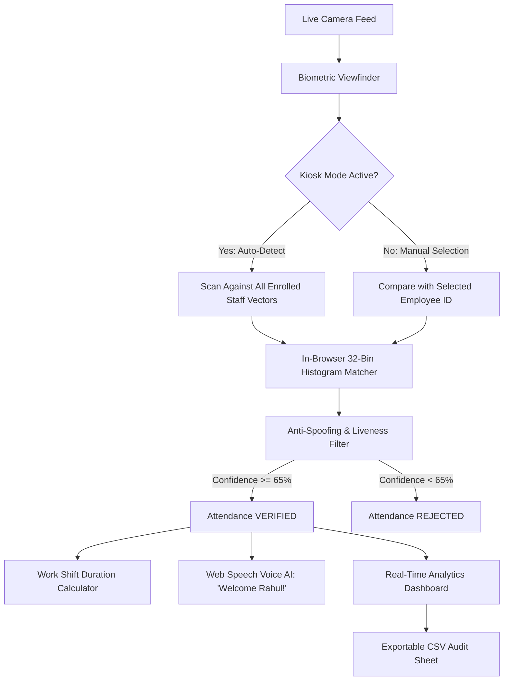

# FaceAttend Pro — Smart AI Employee Biometric Attendance System

> **Enterprise-Grade AI Facial Attendance Platform**  
> An enterprise-grade, touchless facial recognition employee attendance platform with **Monthly Attendance % Analytics**, **Shift Punctuality & Late Arrival Tracking**, **7-Day Trend Visualizer**, and **Biometric Liveness Verification**.

---

## 🌟 Advanced Features Showcased



### 1. 🔐 Employee & Admin Authentication (Gmail & Photo Required)
* **What it does:** 
  * Provides dual-portal authentication supporting both **Admin (HR / Manager)** and **Employee** accounts.
  * **Signup requires:** Valid **Gmail Address**, Full Name, Password, and a **Mandatory Facial Portrait** (snapped live from webcam or uploaded).
  * **Instant Roster Enrollment:** When an employee signs up, their name and Employee ID (`EMP-10X`) are **automatically added to the Employee Selection list** and pre-selected immediately.
  * **1-Click Testing:** Includes built-in quick-fill buttons for **Demo Admin** (`admin@gmail.com` / `admin123`) and **Demo Employee** (`rahul@gmail.com` / `user123`).

### 2. 👤 Dedicated Employee & Admin Profile Page + 👑 Admin Roster Control
* **What it does:** 
  * Displays high-res biometric portrait with an interactive **live camera update button**.
  * Shows Employee ID, Gmail, departmental role, and active vector indicator.
  * **Employee View:** Displays personal **Monthly Attendance Rate %** (evaluated against 75% company target), **Days Present**, **Punctuality Rating**, **Average Shift Hours**, and personal punch history.
  * **Admin View & Extra Management Functions:**
    * **Full Staff Directory & Shift Schedules:** Displays all enrolled staff with their avatars, IDs, emails, roles, and assigned working shifts (e.g. `09:30 AM – 05:30 PM (8h)`).
    * **Who Came Today vs. Who Did Not:** Live categorization flagging employees who **Came Today (Present)** with their check-in time and shift duration, versus who **Did Not Come (Absent)** today.
    * **Interactive Filters & Search:** Filter by `All Employees`, `Came Today`, or `Did Not Come`, with instant search and 1-click shortcut to test any employee in the biometric scanner.
    * **Corporate Oversight Metrics:** Total Staff Managed, Total Audit Logs, and Today's Turnout %.

### 3. 📈 Attendance Percentage & Turnout Analytics
* **What it does:** 
  * Computes live **Workforce Attendance Percentage** (`(Present / Total Enrolled Employees) * 100`).
  * Calculates an **Individual Attendance Track Record %** for each enrolled employee, displaying a progress bar against the mandatory 75% monthly target.
* **Why it impresses:** Delivers actionable HR compliance and attendance visibility.

### 4. ⏰ Configurable Shift Work Time & Late Arrival Tracking
* **What it does:** Allows Administrators to edit the **Shift Start Time** (e.g. `09:30 AM`), **Shift End Time** (`05:30 PM`), **Daily Work Hours Target**, and **Late Grace Period Buffer (Minutes)** via an interactive modal. Live check-in timestamps are compared against the custom shift deadline to automatically flag punches as **On-Time** (emerald badge) or **Late Arrival** (amber badge) and compute live **Punctuality %**.
* **Why it impresses:** Fully flexible for organizations with custom working hours, night shifts, or flexible grace tolerances.

### 5. 📊 7-Day Attendance Trend & Turnout Chart
* **What it does:** Renders a responsive 7-day interactive bar chart tracking day-by-day employee attendance volume and percentages with pure client-side CSS/JS (zero heavy chart libraries).
* **Why it impresses:** Delivers an instant visual overview of weekly workforce attendance patterns.

### 6. 🔍 Multi-Criteria Search & Filter Engine
* **What it does:** Live instant search across employee names and IDs with multi-type filters (`All`, `Today Only`, `Check-In Only`, `Check-Out Only`, `Late Arrivals`).
* **Why it impresses:** Makes auditing large workforces effortless.

### 7. ⏱️ Smart Shift Duration & Work Hours Tracking
* **What it does:** Pairs timestamps between **Punch In** and **Punch Out** to calculate exact shift attendance hours and work duration (e.g., `8h 15m`).

### 8. 🛡️ Client-Side Biometric Cosine Similarity
* Extracts a normalized 32-bin frequency and gradient histogram from the live face crop.
* Computes mathematical **Cosine Similarity** against the enrolled master reference vector.
* Completely free of serverless timeouts or package size limits — runs on any browser at 30 FPS.

### 9. ☁️ Supabase Cloud Database (PostgreSQL Hybrid Sync)
* **What it does:** 
  * Integrates real-time cloud synchronization with **Supabase PostgreSQL** via CDN.
  * **Offline-First Hybrid Architecture:** The app operates 100% reliably out of the box with `localStorage`. When Supabase credentials (URL & Anon Key) are configured, all attendance punches, enrolled staff, and shift timings seamlessly sync to the cloud in real time.
  * **1-Click SQL Setup:** Built-in modal feature with a **"Copy SQL"** button to automatically initialize `employees`, `attendance_logs`, and `shift_settings` PostgreSQL tables in your Supabase dashboard.
  * **Multi-Device Live Sync:** Includes live Realtime channel listeners (`attendance_realtime`) to reflect attendance punches made on separate kiosk terminals instantly.

---

## 🚀 How to Run Locally

Open terminal in the project folder and run:
```powershell
python -m http.server 8000
```
Then visit: **`http://localhost:8000`** in your browser.

---

## ☁️ How to Connect Supabase (Optional Cloud Sync)

1. Create a free project at [supabase.com](https://supabase.com).
2. Click the **"Supabase Sync"** badge in the top navbar of FaceAttend Pro.
3. Click **"Copy SQL"** and run it in your **Supabase Dashboard &rarr; SQL Editor**.
4. Copy your **Project URL** and **Anon Public Key** from Supabase Settings &rarr; API.
5. Paste them into the FaceAttend Pro modal and click **"Save & Connect Cloud"**.
6. Click **"Upload Local to Cloud"** to sync all existing staff and attendance records!

---

## 🌐 Deploy to Vercel / GitHub

```powershell
git add .
git commit -m "Add Supabase PostgreSQL cloud sync with offline-first hybrid engine"
git push
```
Deploys in under 5 seconds with zero serverless crashes!
